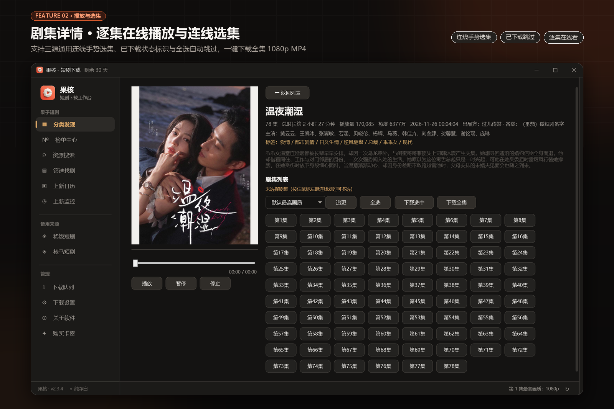
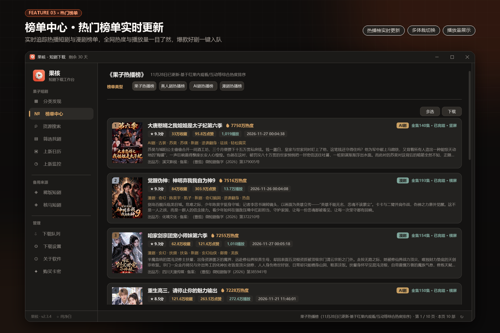
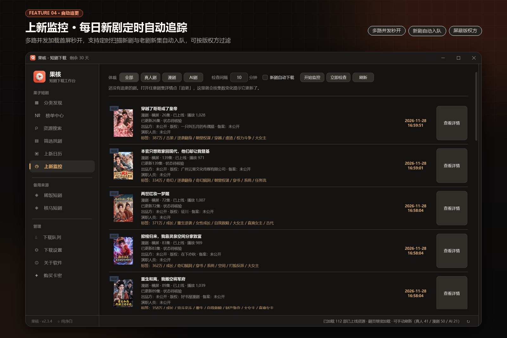

# 红果短剧下载器 · 果核短剧下载


> 红果 / 河马 / 西饭三源聚合的 Windows 短剧 & 漫剧桌面下载工具：支持 **1080p 无水印 MP4 批量下载**、**ByteVC2 新剧自动解密转码**、**粘贴分享链接搜剧**、**上新日历与自动追更监控**、**在线播放**。免安装单文件，下载即用，每台电脑免费试用。


## 🎬 软件功能实操演示


> 上面是自动循环播放的演示动图（27 秒全流程，无声）。
> 想看**带声音的 1080p 完整视频**：[▶ 点开 demo.mp4](https://github.com/lingxiaoyiyu-hub/hongguo-duanju-download/raw/main/assets/demo.mp4)

## ⬇ 立即下载

**[下载 果核短剧下载_v2.3.4.exe（GitHub Releases）](https://github.com/lingxiaoyiyu-hub/hongguo-duanju-download/releases/download/v2.3.4/GuoHe_v2.3.4.exe)**
（172.4MB ｜ Windows 10/11 64 位 ｜ 免安装单文件）

> 国内网络下载慢？用魔搭镜像：[果核短剧下载_v2.3.4.exe（ModelScope 直链不限速）](https://www.modelscope.cn/models/lingxiaoyiyu/xdown-releases/resolve/master/%E6%9E%9C%E6%A0%B8%E7%9F%AD%E5%89%A7%E4%B8%8B%E8%BD%BD_v2.3.4.exe)
> 官网：<https://xcbot.cyou/> ｜ 魔搭发布页：<https://www.modelscope.cn/models/lingxiaoyiyu/xdown-releases>

## 🎁 免费试用

```
XDACDE8FBA80D12204A3
```

把上面的试用卡密贴进登录框，即可免费体验完整功能。
试用卡长期有效，每台电脑均可免费体验一次；换新电脑各有独立体验机会。
试用结束后保留当前下载列表，在登录页点【🛒 购买卡密】获取正式卡后可直接激活续用。

## 三步上手

1. 下载并双击运行（如遇 SmartScreen 蓝色提示：点「更多信息」→「仍要运行」；如双击没反应，右键软件 →「以管理员身份运行」）
2. 输入卡密（还没有正式卡？直接复制上方的免费试用卡体验）
3. 点「验证并登录」，开始使用。首次登录自动绑定本机，**无需填写机器码**

## 核心功能亮点

- **三来源聚合（红果 + 河马 + 西饭）** —— 红果短剧/漫剧主源外，内置**河马短剧**与**西饭短剧**备用源一键切换，主源受限时不断档，三源均支持搜索、分类浏览与全集批量下载
- **真 1080p 无水印 MP4 · ByteVC2 新剧自动解密** —— 内置离线签名与 CENC / ByteVC2 专用解密转码引擎，主流工具报错的新编码剧集也能自动解密转为通用 MP4，支持显卡硬件加速（NVENC / QSV / AMF）
- **高效选集与批量下载** —— 三源通用**剧集连线手势选集**、**已下载状态标识**与**全选自动跳过已下集数**；多线程分片并发、断点续传、每剧独立文件夹与自定义命名模板
- **精准搜剧与七级分类发现** —— 支持剧名、演员、关键词及**粘贴作品分享链接直达**；七级标签组合筛选、横竖屏筛选与播放量展示，找剧精准不迷路
- **榜单中心 · 上新日历 · 自动上新监控** —— 热门榜单实时更新，按日期查看每日上新排播；支持关注剧集与体裁定时追踪，新剧与老剧新集自动入队
- **在线播放 · 解析组件自愈** —— 不下载也能逐集流畅观看；安全软件误删导致解析组件残缺时可自动自愈，并在「下载设置」提供一键「修复解析组件」

**分类发现 —— 七级标签组合筛选，想看的题材一筛即得**


**剧集详情 —— 逐集在线播放，支持连线选集与「下载全集」**



**榜单中心 —— 热门榜单实时更新，全网热度一目了然**



**上新监控 —— 多路并发首屏秒开，关注新剧定时追踪**



## 购买卡密

可在软件登录界面点击【🛒 购买卡密】进入购卡通道，付款后即时自动发卡。

- 卡密首次登录自动绑定设备，一卡一机，无需填写机器码
- **换电脑直接在新机输入卡密登录即可自动换机**（也可点登录页右下角【🔓 自助解绑】），每月共用 2 次免费额度
- 登录后自动心跳保活，意外断线自动返回登录页，队列与进度不丢

## 常见问题

**双击被 Windows SmartScreen 拦截？**
点「更多信息」→「仍要运行」。单文件自解压结构可能触发个别杀软误报，添加信任即可；若杀软拦截导致解析异常，可在软件「下载设置」里点击「修复解析组件」一键自愈。

**双击没有反应 / 打不开？**
先确认软件没有在后台运行（任务管理器结束「果核短剧下载」后重试）；仍不行就右键软件 →「以管理员身份运行」；也可右键 →「属性」→ 勾选「解除锁定」后重试。

**下载失败或速度慢？**
国内网络推荐走魔搭镜像直链下载软件本体；软件内下载剧集时可一键切换到「河马短剧」或「西饭短剧」备用源，也可在「下载设置」里调整并发数（1–16），失败任务支持断点续传与重试。

**换电脑了怎么办？**
**直接在新电脑输入卡密登录即可自动换机**（旧电脑自动下线），无需先手动解绑；也可在登录器界面右下角点击【🔓 自助解绑】。自动换机与自助解绑共用**每月 2 次**免费额度。

**试用提示「免费试用已结束」或「卡密已过期或失效」？**
说明本机的免费体验已用完。点击登录器下方的【🛒 购买卡密】购买正式卡密后，原下载列表自动保留，激活即可继续使用。

## 更新日志

- **v2.3.4**（2026-11-28）：修复了上新监控在跨零点或从上新日历切换进入时实时流漏抓的问题；修复了空扫描缓存锁死及并发过高偶发导致零点新剧显示不全的问题。
- **v2.3.3**（2026-11-27）：修复了搜索与部分剧集详情漏拉播放量、显示播放量未公开的问题；修复了安全软件拦截导致解析组件残缺时自动自愈及选集兜底解析；新增了河马短剧列表封面与剧集详情的已下载状态标识及全选自动跳过；新增了下载设置页「修复解析组件」一键自检修复入口；优化了上新监控多路并发加载与缓存分页，大幅缩短首屏与切体裁等待。

> 更早历史版本请查看 [GitHub Releases](https://github.com/lingxiaoyiyu-hub/hongguo-duanju-download/releases)。

## 免责声明

本工具仅供个人学习与技术研究使用，请于体验后自行删除，勿用于商业用途。所有短剧内容的版权归原权利方所有，请支持正版。使用本工具所产生的任何问题由使用者自行承担。
