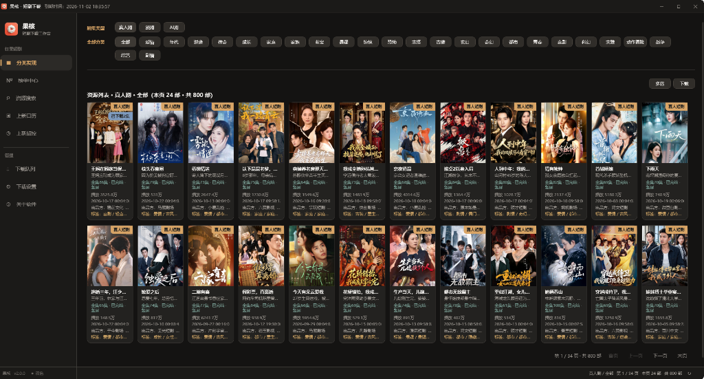
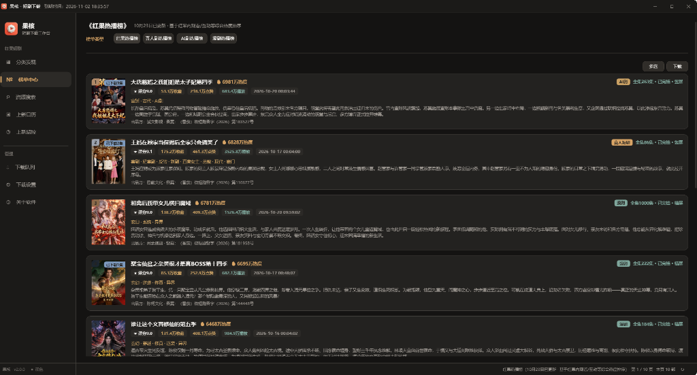
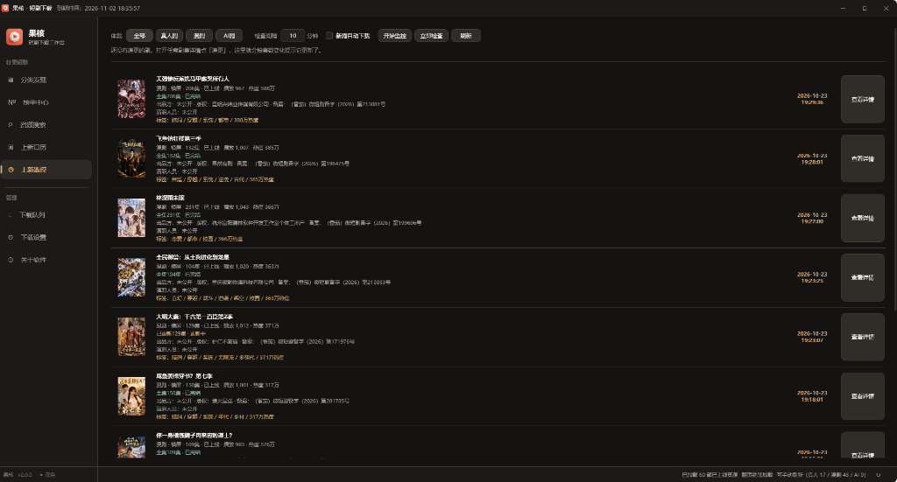

# 红果短剧下载器 · 果核短剧下载


> 红果短剧/漫剧 Windows 桌面下载工具：搜索、在线播放、批量下载，追剧一站式完成。全新黑曜石高级暗黑质感与珊瑚橙配色，免安装，下载即用。



## 🎬 软件功能实操演示


> 上面是自动循环播放的演示动图（27 秒全流程，无声）。
> 想看**带声音的 1080p 完整视频**：[▶ 点开 demo.mp4](https://github.com/lingxiaoyiyu-hub/hongguo-duanju-download/raw/main/assets/demo.mp4)

## ⬇ 立即下载

**[下载 果核短剧下载_v2.0.5.exe（GitHub Releases）](https://github.com/lingxiaoyiyu-hub/hongguo-duanju-download/releases/download/v2.0.5/XDown_v2.0.5.exe)**
（115.3MB ｜ Windows 10/11 64 位 ｜ 免安装单文件 ｜ 体积较上版缩减 53%）

> 国内网络下载慢？用魔搭镜像：[果核短剧下载_v2.0.5.exe（ModelScope 直链）](https://www.modelscope.cn/models/lingxiaoyiyu/xdown-releases/resolve/master/%E6%9E%9C%E6%A0%B8%E7%9F%AD%E5%89%A7%E4%B8%8B%E8%BD%BD_v2.0.4.exe)

## 它能做什么

- **资源搜索 / 分类发现** —— 关键词找剧，按体裁分类浏览，精准不迷路
- **榜单中心** —— 热门榜单实时更新，永远有剧可追
- **上新日历** —— 按日期查看每天上新与排播，新剧先人一步
- **上新监控** —— 定时自动追更，关注的新剧更新即入队
- **批量下载** —— 整部剧多选一次入队，最高画质、多线程并发、每剧独立文件夹、可选自动转码
- **在线播放** —— 不下载也能直接看


**分类发现 —— 七级标签组合筛选，想看的题材一筛即得**


**剧集详情 —— 逐集在线播放，支持「下载全集」**


**榜单中心 —— 热门榜单实时更新，全网热度一目了然**



**上新监控 —— 按需分页首屏秒开，关注新剧定时追踪**



## 三步上手

1. 下载并双击运行（如遇 SmartScreen 蓝色提示：点「更多信息」→「仍要运行」）
2. 输入卡密（还没有？先用下方的免费试用卡）
3. 点「验证并登录」，开始使用。首次登录自动绑定本机，**无需填写机器码**

## 🎁 免费试用（每台电脑 1 小时）

```
XDACDE8FBA80D12204A3
```

把上面的试用卡密贴进登录框，即可体验完整功能 1 小时。
试用卡长期有效，但**每台电脑只能激活一次**；换新电脑各有独立的一次机会。
试用结束后如需继续使用，请购买卡密。

## 购买卡密

| 档位 | 价格 | 折合 |
| :--- | :--- | :--- |
| 月卡 | ¥28 | — |
| 季卡 | ¥68 | 短期使用 |
| 年卡 | ¥138 | **≈ 11.5 元/月** |
| 永久卡 | ¥198 | 一次付费，永不过期 |

**购买请加客服 QQ：574719738**（备注「果核」），付款后即时发卡。

- 卡密首次登录自动绑定设备，一卡一机
- 换电脑请联系客服解绑，新机登录即重新绑定
- 登录后自动心跳保活，意外断线自动返回登录页，进度不丢

## 常见问题

**双击被 Windows SmartScreen 拦截？**
点「更多信息」→「仍要运行」。单文件自解压结构可能触发个别杀软误报，添加信任即可。

**下载失败或速度慢？**
国内网络推荐走魔搭镜像直链；任务支持失败重试，也可在「下载设置」里调整并发数（1-16）。

**换电脑了怎么办？**
在登录器界面右下角点击【🔓 自助解绑】即可（每个卡密每月可免费自助换机 2 次），新电脑输入卡密登录即可自动重新绑定。

**试用 1 小时后提示「卡密已过期或失效」？**
那是本机的免费体验已用完（试用卡每台电脑限 1 小时）。点击登录器下方的【🛒 购买卡密】即可前往卡网购买继续使用。

## 更新日志

- **v2.0.5**（2026-10-29）：修复登录窗口高度溢出导致登录与退出按钮在部分缩放率下被挤压截断的问题；新增登录界面卡密自助解绑功能，支持安全换机与当月限额提示（每月可自助解绑 2 次）；新增登录界面一键直达卡网购买卡密入口；更改登录界面底部操作栏布局，窗口支持根据内容自适应高度展开；服务端全面上线第一套多层智能安全防御引擎（毫秒级频率限制 + 恶意违规关小黑屋 + 试用防刷农场 + 日志安全轮转）。
- **v2.0.4**（2026-10-28）：修复短视频切片并发与弱网抖动导致的下载停顿问题；修复下载重试时已下载进度显示假死卡住的问题；新增云端动态路由与规则下发引擎，后续接口与风控变动均可动态热生效无需频繁更新客户端；更改单集下载策略，常规剧集单流直写提升下载流畅度与抗波动能力。
- **v2.0.3**（2026-10-27）：修复搜索受上游风控抖动与代理标头缺失影响报错的问题；修复分类发现卡片未展示播放量、发布时间与出品方；修复上新监控与日历刷新时数据跳变及首屏数据不稳定的问题；修复视频解析取播放地址偶发空响应及本地签名连接异常；新增「筛选找剧」支持多选剧集与一键批量下载；更改筛选找剧与搜索页面的网格卡片排版间距。
- **v2.0.2**（2026-10-25）：搜索结果不再混入一堆无关推荐，剧名对得上的排在最前；资源搜索框可直接粘贴作品分享链接，自动识别并打开对应短剧；上新日历与上新监控切到别的板块再回来不再重新加载，保留原来的页码与滚动位置。
- **v2.0.1**（2026-10-23）：品牌升级为「果核」，更换全新黑底珊瑚红图标；上新监控改为按页加载，首屏由约 34 秒降至 1 秒级，并修复翻页后时间顺序颠倒；修复深色主题下剧名、集名、设置项文字看不清；修复多选下载退出后再次进入失效、保存位置选完文件夹不显示路径、检查间隔看不到数字、鼠标停在列表上滚轮无效等问题；登录页不再展示机器码；窗口改为圆角外观。单文件体积由 244.7MB 缩减至 115.2MB。
- **v1.9.6**（2026-10-22）：修复搜索失效的问题（官网搜索页改版后已切换到新搜索接口，搜索结果、详情跳转和原来完全一致）。
- **v1.9.5**（2026-10-22）：修复上新日历取不到数据、只能刷出兜底候选的问题（官方日历接口恢复签名直连：当天约 30 条首发与更新剧目，每条带真实更新时间）；修复日历翻页空转；新增 15 天日期条，点哪天看哪天。
- **v1.9.4**（2026-10-21）：首页刷新提速约 7 倍（不再等约一分钟）；限流后不再白屏；新增「有新集」提示——首页显示几部有新集，卡片标注新增集数。
- **v1.9.3**（2026-10-18）：首页、上新日历、上新监控新增「刷新」按钮，只在点击时联网取数，页面不再自动刷新；有新剧时刷新按钮标红显示「新 N」，点一次即清零。上新监控仍按设定间隔自动检查并自动下载，只是不再重刷页面。同时把剧集列表抓取的起始并发由 1 提到 3，大批量翻页明显更快。
- **v1.9.1**（2026-10-14）：修复下载任务取不到播放地址、整片下载失败的问题（签名算法已换代）；内容身份支持自动轮换。
- **v1.9.0**（2026-10-14）：修复下载任务频繁失败的问题（取地址偶发空响应，现已自动重试）。
- **v1.8.9**（2026-10-13）：修复下载全部失败的问题（红果取播放地址接口改版，已适配）。
- **v1.8.8**（2026-10-13）：修复首页与上新页不实时更新的问题（现每 10 分钟自动刷新）；设置页新增「关于软件」卡（版本号 / 检查更新 / 免责声明）；启动时提示新版本（不强制）；优化刷新请求量。
- **v1.8.5**（2026-09-29）：首个公开发布版本。

## 免责声明

本工具仅供个人学习与技术研究使用，请于体验后自行删除，勿用于商业用途。所有短剧内容的版权归原权利方所有，请支持正版。使用本工具所产生的任何问题由使用者自行承担。
